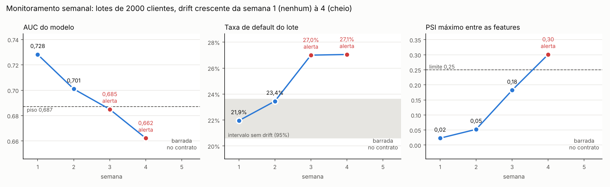
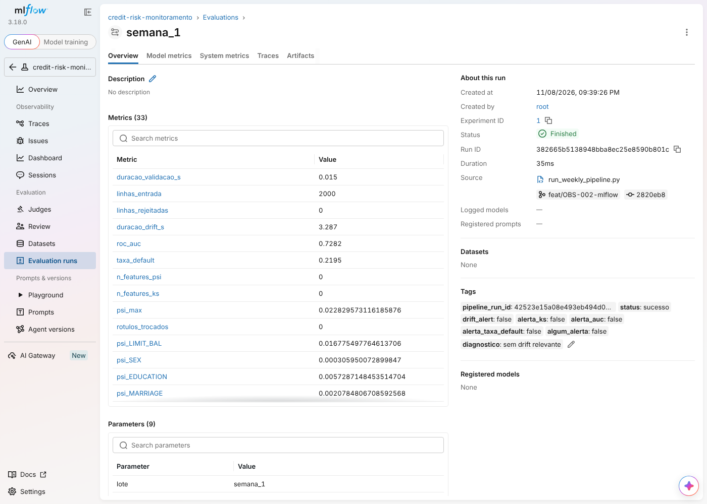
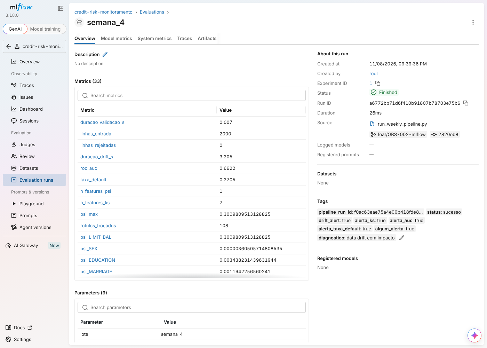

# credit-risk-observability

[](https://github.com/VitorAkira-me/credit-risk-observability/actions/workflows/ci.yml)
[](https://github.com/VitorAkira-me/credit-risk-observability/actions/workflows/pipeline.yml)

Camada de sustentação de um modelo de **Credit Scoring** em produção: contratos de qualidade de
dados, simulação e detecção de drift, observabilidade do pipeline e governança (LGPD).
Tech Challenge Fase 4 (Pós-tech ML).

> Status: em construção. Concluído: dados, baseline, Etapa 1 (contrato), Etapa 2 (drift) e o
> monitoramento da Etapa 3 (log estruturado e MLflow).
> Andamento em [`docs/STATUS.md`](docs/STATUS.md) e [`docs/KANBAN.md`](docs/KANBAN.md).

## Dataset
[Default of Credit Card Clients (UCI, Taiwan)](https://archive.ics.uci.edu/dataset/350):
30.000 clientes, alvo binário `default` (22,12% de inadimplência). Baixado sem login via
`ucimlrepo`. Escolha justificada em [ADR-001](docs/decisions/ADR-001-dataset.md).

## Como rodar
Pré-requisito: [uv](https://docs.astral.sh/uv/). O uv instala o Python 3.12 se precisar.
Os comandos funcionam iguais no PowerShell e no Git Bash.

```
uv sync                                   # ambiente com versões fixadas pelo uv.lock
uv run python scripts/prepare_data.py     # download, EDA e split Referência / Produção
uv run python scripts/train_baseline.py   # treina o baseline e salva métricas
uv run python scripts/make_corrupted_batch.py                            # lote com defeitos conhecidos
uv run python scripts/run_validation.py data/production/batch_corrupted.parquet   # exit 1: bloqueado
uv run python scripts/make_drift_batch.py --scenario data_drift --intensity 1      # lote com data drift
uv run python scripts/make_drift_batch.py --scenario concept_drift --intensity 1   # lote com concept drift
uv run python scripts/run_drift_report.py data/production/production_base.parquet          # controle
uv run python scripts/run_drift_report.py data/production/batch_data_drift_i100.parquet    # relatório de data drift
uv run python scripts/run_drift_report.py data/production/batch_concept_drift_i100.parquet # relatório de concept drift
uv run python scripts/calibrate_alerts.py      # réguas de alerta para lotes de 2.000 (Etapa 3)
uv run python scripts/run_weekly_pipeline.py   # 5 semanas simuladas, cada uma vira um run do MLflow
uv run python scripts/plot_weekly_panel.py     # painel estático em reports/figures/
uv run python scripts/run_fairness.py          # auditoria de viés por sexo e idade (Etapa 4)
uv run mlflow ui --backend-store-uri sqlite:///mlflow.db   # painel vivo em http://localhost:5000
uv run pytest -q                          # testes
uv run ruff check . ; uv run ruff format --check .
```

## Referência vs Produção
| Conjunto | Arquivo | Linhas | Uso |
|---|---|---|---|
| Referência | `data/reference/reference.parquet` | 21.000 | treino e validação do modelo |
| Produção | `data/production/production_base.parquet` | 9.000 | nunca entra no treino; base para os lotes com drift |

Split estratificado (seed 42), 0 clientes em comum. Detalhes em [DATA-001](docs/specs/DATA-001.md);
EDA em [`reports/eda/eda_summary.md`](reports/eda/eda_summary.md).

## Modelo baseline
LogisticRegression balanceada. `SEX` e `MARRIAGE` ficam fora das features
([ADR-004](docs/decisions/ADR-004-features-sensiveis.md)).

| Conjunto | AUC | KS | Recall default |
|---|---|---|---|
| Validação | 0,732 | 0,384 | 0,657 |
| Produção sem drift | 0,715 | 0,365 | 0,640 |

Métricas completas em [`models/baseline_metrics.json`](models/baseline_metrics.json) e [ML-001](docs/specs/ML-001.md).

## Etapa 1 · Contrato de dados
Schema Pandera `credit_default_input_v1` com 9 regras rígidas (colunas exatas, `int64` sem
nulos, `ID` único, `AGE` 18 a 100, `LIMIT_BAL` > 0, domínio dos códigos, `PAY_AMT` ≥ 0, alvo
binário, lote não vazio). Regras e decisões em [DQ-001](docs/specs/DQ-001.md).

`scripts/run_validation.py` é o portão de ingestão: lote limpo sai com exit 0; lote inválido sai
com **exit 1**, log `validation_failed` e falhas em `reports/validation/`.

| Lote | Linhas | Resultado | Falhas por regra |
|---|---|---|---|
| Produção-base | 9.000 | aprovado (exit 0) | nenhuma |
| Corrompido | 1.020 | **bloqueado (exit 1)** | AGE 50, ID duplicado 40, LIMIT_BAL nulo 30 (+30 de tipo), SEX 10 |

As contagens batem exatamente com os defeitos injetados ([DQ-002](docs/specs/DQ-002.md)).

## Relatórios de drift: o que fica no git
Os 3 relatórios de `reports/drift/drift_report_*` são a evidência da Etapa 2: ficam versionados e não
devem ser regerados em PRs futuros, porque cada regeneração soma cerca de 4,7 MB ao histórico.
Desde o OBS-001, `scripts/run_drift_report.py` grava por padrão em `outputs/drift/`, fora do git, e não
toca na evidência. No OBS-002, esses relatórios viram artefatos do MLflow.

## Log estruturado do pipeline (OBS-001)
Cada etapa (`validacao`, `geracao_lote_drift`, `relatorio_drift`) grava uma linha JSON em
`logs/pipeline.jsonl`, sempre com os mesmos campos:

| Campo | O que é |
|---|---|
| `timestamp` | fim da etapa, em UTC |
| `run_id` | identifica a execução e liga o log ao manifesto e ao relatório |
| `etapa` / `evento` | qual parte rodou e o que aconteceu (ex.: `validation_failed`) |
| `status` | `sucesso` ou `falha`; exceção inesperada também vira `falha` |
| `duracao_s` | latência da etapa, em segundos |
| `linhas_entrada` / `linhas_rejeitadas` | volume que entrou e linhas com falha no contrato |
| `detalhe` | lote, motivo, falhas por regra, diagnóstico de drift |

O log guarda só contagens, nomes de regra e nomes de arquivo: nenhum ID nem valor de linha (Etapa 4).

## Etapa 3 · Monitoramento semanal no MLflow (OBS-002)
A Produção-base vira 4 semanas de 2.000 clientes, sem cliente repetido, com drift crescente
(semana 1 sem drift; semana 4 com o data drift e o concept drift cheios do DRIFT-001), mais uma
semana com lote corrompido. Cada semana passa pelo contrato, pelo relatório de drift e pelas réguas
de alerta, e vira um run do MLflow com o mesmo `run_id` do `logs/pipeline.jsonl`.



| Régua | Dispara quando | Por quê | Alarme falso medido* |
|---|---|---|---|
| `drift_alert` (PSI) | PSI > 0,25 em alguma feature | mudança grande na distribuição (limite usual em crédito) | (não calibrado) |
| `alerta_ks` | p < 0,0025 (0,05 / 20, Bonferroni) e D > D mínimo | 20 testes por lote: com p < 0,05 a régua antiga alarmava em 24,5% das semanas sem drift | 1,5% |
| `alerta_auc` | AUC < 0,687 | piso do bootstrap da Produção-base com n = 2.000 (percentil 2,5) | 3,5% |
| `alerta_taxa_default` | taxa fora de 20,6% a 23,6% | o PSI do alvo não vê 22% virar 27% (concept drift) | 7,0% |

\* Em 200 amostras sem drift que a calibração não viu. Limites em
[`reports/monitoring/alert_thresholds.json`](reports/monitoring/alert_thresholds.json).

| Semana | Drift | AUC | Default | PSI máx | Alertas |
|---|---|---|---|---|---|
| 1 | nenhum | 0,728 | 21,9% | 0,02 | nenhum |
| 2 | 1/3 | 0,701 | 23,4% | 0,05 | KS (`LIMIT_BAL`, `BILL_AMT1`) |
| 3 | 2/3 | 0,685 | 27,0% | 0,18 | KS (limite e 6 faturas), AUC, default |
| 4 | cheio | 0,662 | 27,1% | 0,30 | PSI (`LIMIT_BAL`), KS, AUC, default |
| 5 | lote corrompido | barrada no contrato (130 linhas rejeitadas) | | | `status=falha` |

Leitura: o concept drift aparece antes do data drift. Na semana 3 a AUC e a taxa de default já
alarmam, e o PSI ainda está em 0,18. Um monitoramento só de PSI perderia uma semana.

O que cada run guarda: params (lote, semana, intensidade, versão do modelo, contrato, método de
drift), métricas no eixo "semana" (latência por etapa, linhas de entrada e rejeitadas, AUC, taxa de
default, PSI por feature, nº de features com alerta) e artefatos (HTML do Evidently, eventos do
log e, na semana barrada, as falhas do contrato). `mlflow.db`, `mlartifacts/` e `outputs/` ficam
fora do git; a evidência versionada é o painel e os limites calibrados.

## Métricas de saúde: o que cada número do painel quer dizer (OBS-003)
Cada semana é um run do MLflow (`uv run mlflow ui --backend-store-uri sqlite:///mlflow.db`) e uma
linha por etapa em `logs/pipeline.jsonl`. Os limites valem para lotes de 2.000 clientes.

| Métrica | O que mede | Por que importa | Limiar de alerta | Onde ver |
|---|---|---|---|---|
| `status` | se a etapa terminou bem (`sucesso`) ou não (`falha`) | pergunta 1: o pipeline rodou? | qualquer `falha` | tag `status` no MLflow; campo `status` no log |
| `linhas_entrada` | quantos clientes chegaram no lote | lote truncado ou duplicado aparece aqui antes de virar drift | diferente do esperado (2.000) | métrica no MLflow; campo no log |
| `linhas_rejeitadas` | clientes com ao menos uma falha no contrato | dado sujo não pode chegar ao modelo | maior que 0 (o lote inteiro é barrado) | métrica; `detalhe.falhas_por_regra` no log |
| `duracao_validacao_s`, `duracao_drift_s` | latência de cada etapa | pergunta 2: rodou bem? Lentidão anuncia lote anormal ou máquina sobrecarregada | sem limiar calibrado; referência: 0,01 s e 3 s | métricas; `duracao_s` no log |
| `roc_auc` | se o modelo ainda ordena bem quem paga e quem não paga | pergunta 3: o modelo ainda é confiável? É o efeito que importa ao negócio | abaixo de 0,687 | métrica; tag `alerta_auc` |
| `taxa_default` | proporção de clientes que deram calote no lote | concept drift e mudança econômica aparecem aqui primeiro | fora de 20,6% a 23,6% | métrica; tag `alerta_taxa_default` |
| `psi_<feature>`, `psi_max` | quanto a distribuição de cada feature mudou desde o treino | data drift: o público mudou | PSI acima de 0,25 (entre 0,10 e 0,25, atenção) | métricas; tag `drift_alert` |
| `n_features_psi`, `n_features_ks` | quantas features alarmaram em cada teste | uma feature é sinal localizado; muitas são mudança de público | maior que 0 | métricas; tag `alerta_ks` |
| `rotulos_trocados` | rótulos trocados pela simulação de concept drift | controle do experimento, não existe em produção real | não se aplica | métrica |

| Semana 1: saudável | Semana 4: com alerta |
|---|---|
|  |  |

**Retreinar ou não?** O que fazer conforme o que acende:
1. **`status=falha`:** o problema é o dado, não o modelo. Corrigir a origem do lote; retreinar não resolve.
2. **Só PSI ou KS, com AUC e default normais:** data drift sem impacto (ex.: semana 2). Observar a
   tendência e descobrir a causa da mudança; ainda não retreinar.
3. **AUC ou taxa de default fora da faixa:** o modelo está errando mais (ex.: semanas 3 e 4).
   Abrir a análise causal (GOV-004) e, confirmado o concept drift, retreinar com dados recentes rotulados.

## CI/CD no GitHub Actions (IMP-001)
| Workflow | Quando roda | O que garante |
|---|---|---|
| [`ci.yml`](.github/workflows/ci.yml) | todo PR para a `main` e todo merge | **Qualidade:** `uv sync --locked`, ruff e pytest. **Contrato:** com os dados reais do UCI, a Produção-base passa, o lote corrompido é barrado com as falhas exatas e os lotes regerados batem com os hashes da evidência em `reports/drift/` (`scripts/check_evidence.py`). |
| [`pipeline.yml`](.github/workflows/pipeline.yml) | todo merge na `main` e manual | Roda o pipeline de monitoramento inteiro, confere que os limites calibrados não mudaram sem decisão e publica como artefato da execução: relatórios das semanas, `mlflow.db`, `mlartifacts/`, log e painel (sem o `failure_cases.csv`, que tem valores de linha). |

Um PR que afrouxa o contrato fica vermelho mesmo quando o lote corrompido continua barrado por
outras regras: o portão compara as falhas regra a regra, e não só o exit code.

## Estrutura
```
src/credit_risk_observability/   # pacote: config, data/, model/, contracts/, drift/, monitoring/
scripts/                         # pontos de entrada do pipeline
tests/                           # pytest
reports/                         # evidências versionadas (EDA, relatórios de drift)
models/                          # métricas versionadas; modelo .joblib regerável
docs/                            # STATUS, KANBAN, GLOSSARIO, specs/ e decisions/ (ADRs)
data/                            # fora do git (regerável pelos scripts)
```

## Governança (LGPD, vieses, análise causal)
> Plano técnico de conformidade, não parecer jurídico. As citações da Lei 13.709/2018 (LGPD) estão
> parafraseadas e listadas para conferência no texto oficial em `docs/specs/GOV-001.md`.

### Inventário de dados pessoais (GOV-001)
Todo o dataset é **dado pessoal** (art. 5º, I): cada linha descreve uma pessoa e o `ID` a torna
identificável. Nenhuma coluna é **dado pessoal sensível** no sentido do art. 5º, II (origem racial,
religião, saúde, vida sexual, biometria e afins), mas quatro delas têm **risco discriminatório**,
e é aí que mora o cuidado (princípio da não discriminação, art. 6º, IX).

| Coluna | O que é | Risco discriminatório? | Entra no modelo? | Tratamento |
|---|---|---|---|---|
| `ID` | identificador do cliente | não, mas identifica a pessoa | não | só em `data/` (fora do git); nunca em relatório, log, MLflow ou artefato de CI (ADR-005) |
| `SEX` | sexo | **sim** | **não** (ADR-004) | mantido apenas para auditar viés (GOV-003) |
| `MARRIAGE` | estado civil | **sim** | **não** (ADR-004) | mantido apenas para auditar viés |
| `EDUCATION` | escolaridade | **sim** (pode ser proxy de renda e sexo) | sim | monitorado no viés e no drift |
| `AGE` | idade | **sim** (faixa etária) | sim | uso legítimo em crédito; monitorado no viés (GOV-003) |
| `LIMIT_BAL` | limite de crédito | não | sim | |
| `PAY_0`, `PAY_2` a `PAY_6` | meses de atraso no pagamento | não | sim | |
| `BILL_AMT1` a `BILL_AMT6` | valor das faturas | não | sim | |
| `PAY_AMT1` a `PAY_AMT6` | valor pago | não | sim | |
| `default` | calote no mês seguinte (alvo) | não | é o alvo | usado só para treinar e medir |
| score do modelo | probabilidade de calote | não | é a saída | só em memória; nunca gravado em disco |

**Por que o `ID` é descartado das saídas, e não trocado por um hash:** os IDs do UCI são
sequenciais (1 a 30.000). Um hash sem segredo se desfaz testando os 30.000 valores. Como nenhuma
saída precisa identificar o cliente, a opção mais simples e segura é não gravá-lo. Num sistema real,
a pseudonimização (art. 13, §4º) seria feita na ingestão com HMAC-SHA256 e uma chave guardada fora
do código, e o dado continuaria sendo pessoal, porque quem tem a chave reidentifica.

### Privacy by Design: o que o código já faz
| Medida | Onde | Como é garantida |
|---|---|---|
| Minimização de colunas | modelo usa 21 de 23 features; `SEX` e `MARRIAGE` fora (ADR-004) | `MODEL_FEATURES` em `config.py`; teste do ML-001 |
| Dados fora do git | `data/`, `outputs/`, `logs/`, `mlflow.db`, `mlartifacts/` no `.gitignore` | só agregados e relatórios minimizados são versionados |
| Relatórios sem valores de cliente | `reports/validation/` tem só regra e posição da linha (ADR-005) | teste varre os CSV versionados e falha se achar valor ou `ID` |
| Logs sem PII | `logs/pipeline.jsonl` guarda contagens, regras e nomes de arquivo | teste com IDs marcados; exceção grava só o tipo do erro |
| MLflow só com agregados | métricas, tags e relatórios; o lote nunca é enviado | `tracking.py`; arquivo de falhas minimizado |
| Nada sai da máquina | telemetria do Evidently e do MLflow desligada antes do import | teste do Evidently; variáveis em `tracking.py` |
| Artefato de CI sem detalhe | `pipeline.yml` exclui o arquivo de detalhe das falhas | regra de exclusão no upload |
| Acesso mínimo | projeto local; em produção, o detalhe das falhas ficaria restrito ao time de dados | a definir na retenção (GOV-002) |

### Viés por grupo (GOV-003)
Aprovar = o modelo prever que o cliente paga (score abaixo de 0,5). Duas métricas de justiça:
**paridade demográfica** (os grupos são aprovados na mesma proporção?) e **igualdade de
oportunidade** (entre quem de fato paga, os grupos são aprovados na mesma proporção?). A **regra dos
4/5** sinaliza impacto desigual quando a menor taxa de aprovação é menos de 80% da maior.
Números em [`reports/fairness/fairness_report.json`](reports/fairness/fairness_report.json)
(`uv run python scripts/run_fairness.py`); só taxas agregadas, com centenas a milhares de clientes por grupo.

| Conjunto | AUC | Sexo: paridade | Sexo: razão 4/5 | Idade: paridade | Idade: razão 4/5 | Idade: oportunidade |
|---|---|---|---|---|---|---|
| Referência (treino) | 0,729 | 0,074 | 0,887 | 0,231 | **0,661** | 0,241 |
| Produção-base | 0,715 | 0,051 | 0,920 | 0,228 | **0,663** | 0,237 |
| Data drift | 0,714 | 0,051 | 0,919 | 0,213 | **0,681** | 0,224 |
| Concept drift | 0,665 | 0,051 | 0,920 | 0,228 | **0,663** | 0,245 |

**O que os números dizem:**
- **Sexo:** mulheres aprovadas 5 pontos a mais que homens (63,6% contra 58,5%), em linha com a
  taxa real de default (21,0% contra 23,9%). Passa na regra dos 4/5.
- **Idade: o problema está aqui.** Clientes com 50 anos ou mais são aprovados em 44,8% dos casos,
  contra 67,6% na faixa de 30 a 39; entre bons pagadores, 50,6% contra 74,3%. Reprova na regra dos 4/5.
- **O drift e a justiça:** o data drift reduziu um pouco a disparidade por idade (0,228 para 0,213);
  o mecanismo ainda não foi isolado (o corte de limite e a alta das faturas mexem nos grupos de forma
  diferente). O concept drift não mudou quem é aprovado (as
  entradas são as mesmas), mas aumentou a injustiça entre bons pagadores (0,237 para 0,245): os
  novos inadimplentes se concentram no grupo de faturas altas.

**Tirar `SEX` do modelo resolve?** Em parte. As features do modelo adivinham o sexo com AUC 0,577
(0,5 seria nada): há proxy, mas fraco. O contrafactual com `SEX` e `MARRIAGE` de volta dobraria a
disparidade por sexo (0,051 para 0,125). Então retirar ajudou, mas a diferença que sobra vem do
proxy e da diferença real de default. Para idade, o mesmo teste mostra que tirar `AGE` reduz a
disparidade (0,228 para 0,134; razão 0,800) a um custo de 0,0012 de AUC, mas os menores de 29
passam a ser os menos aprovados: o limite de crédito funciona como proxy de idade.

**Mitigação proposta ([ADR-006](docs/decisions/ADR-006-vies-por-idade.md), aguardando decisão):**
tirar `AGE` no próximo retreino e encaminhar à revisão humana as negativas dos grupos com
disparidade, com a auditoria rodando a cada retreino e a regra dos 4/5 como critério de aprovação.

