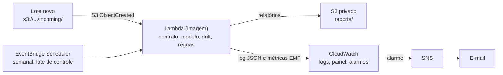

# ADR-007 · Arquitetura do pipeline na AWS

- Status: proposta (Claude, 10/11/2026), aguardando o ok do Akira antes do primeiro `cdk deploy`
- Data: 10/11/2026
- Jira: [PMF4-42](https://akiravkax.atlassian.net/browse/PMF4-42), épico PMF4-41
- Corte: 13/11/2026 às 18h. Nada aqui bloqueia a entrega.

## Contexto
O pipeline roda no computador e no CI. Queremos o mesmo fluxo (contrato, modelo, drift, alerta) em
ferramentas de mercado: disparado quando um lote chega e toda semana, com logs, métricas, painel e
alerta por e-mail, descrito em código e removível com um comando.

Fatos medidos antes de decidir:

| Fato | Valor | Como foi conferido |
|---|---|---|
| Plano da conta | FREE, com US$ 100 de crédito, até 09/05/2027 | `GetAccountPlanState` |
| Região | `sa-east-1` (São Paulo) | perfil `RM371483` em `~/.aws/config` |
| Serviços | Lambda, ECR, S3, CloudWatch, SNS, EventBridge, CloudFormation disponíveis | lista oficial do plano e disponibilidade em `sa-east-1` |
| Stacks existentes | nenhuma | `ListStacks` |
| Duração por lote | de 12 a 32 s no computador | sequência do README no PowerShell |
| Tamanho das dependências | acima de 250 MB | pandas, scikit-learn e Evidently |

## Opções de computação
| Opção | Prós | Contras |
|---|---|---|
| **A. Lambda com imagem de contêiner** | paga só quando roda; escala a zero; gatilho nativo do S3; sem rede para administrar | limite de 15 min por execução (o lote leva segundos) |
| B. ECS Fargate agendado | sem limite de tempo | precisa de VPC, cluster e definição de tarefa; mais peças para um trabalho de segundos |
| C. EC2 | controle total | paga parado; patches e disco por conta própria |

## Decisão
**Opção A.** Lote semanal de segundos, com longos períodos parados, é o caso clássico de função sob
demanda. A imagem de contêiner é obrigatória: as dependências passam do limite de 250 MB do pacote zip.

Escolhas que acompanham a decisão:

1. **Gatilho restrito a `incoming/`, relatórios em `reports/`.** Prefixos separados impedem o laço em que
   a função grava um arquivo que dispara a própria função.
2. **Sem novas tentativas no gatilho assíncrono.** O padrão do Lambda repete duas vezes; um lote com erro
   geraria três execuções e três alarmes. O contrato reprovado **não** é erro: a função termina bem e
   publica a métrica.
3. **Métricas por Embedded Metric Format (EMF):** uma linha JSON no log vira métrica no CloudWatch, sem
   chamada de API nem biblioteca nova.
4. **Réguas só para o tamanho calibrado.** Os limites valem para lotes de 2.000 linhas. Lote de outro
   tamanho dá erro explícito, a mesma proteção do `run_weekly_pipeline.py`.
5. **Dados fora da imagem.** Referência, modelo e limites ficam em `seed/` no S3. A imagem só tem código.
6. **Bucket privado:** bloqueio de acesso público, criptografia, TLS obrigatório e expiração que segue o
   plano de retenção do GOV-002 (lotes em 30 dias, relatórios em 90). Logs: 180 dias.
7. **Tópico SNS sem KMS, com TLS obrigatório.** A skill da AWS sugere a chave `alias/aws/sns`, mas o
   CloudWatch [não consegue publicar](https://repost.aws/knowledge-center/cloudwatch-configure-alarm-sns)
   em tópico com essa chave, e o e-mail nunca chegaria. A alternativa é uma chave própria (US$ 1 por mês).
   Como a mensagem só carrega o nome do alarme, sem dado de cliente, a chave não protegeria nada.
8. **E-mail como parâmetro do deploy.** O repositório é público: o endereço não entra no código.
9. **IaC em AWS CDK com Python**, a mesma linguagem do projeto, em um projeto separado (`infra/`, com
   lockfile próprio). No mesmo lockfile, o `aws-cdk-lib` rebaixou o `typeguard` usado pelo Pandera de
   4.6.0 para 2.13.3, o que mudaria o ambiente que gerou a evidência.

## LGPD
Tudo fica em `sa-east-1`: num cenário real, os dados dos clientes não sairiam do Brasil, o que evita as
regras de transferência internacional (LGPD, Capítulo V). O e-mail de alarme leva só o nome do alarme.
Os logs mantêm a regra do projeto: contagens, nomes de regra e de arquivo, nunca valores de linha.

## Custo estimado (`sa-east-1`, preços da API de preços da AWS em 10/11/2026)
Cenário: 100 execuções no mês, 3 GB de memória, 30 s cada, imagem medida de 1,98 GB (449 MB compactada).

| Item | Conta | Por mês |
|---|---|---|
| Lambda | 9.000 GB-s × US$ 0,0000166667 (antes da cota grátis) | US$ 0,15 |
| ECR (imagem, guardada compactada) | 0,45 GB × US$ 0,10 | US$ 0,05 |
| S3 | menos de 1 GB × US$ 0,0405 | US$ 0,04 |
| CloudWatch | 8 métricas (US$ 0,30 cada, se fora da cota grátis) | até US$ 2,40 |
| CloudWatch Logs | menos de 0,1 GB | US$ 0,09 |
| SNS, Scheduler, alarmes, painel | dentro das cotas grátis | US$ 0 |
| **Total** | | **até cerca de US$ 3, coberto pelo crédito de US$ 100** |

No plano FREE, o crédito cobre o uso e a conta não é cobrada. Se a conta passar para o plano pago, vale
criar um limite de gasto em AWS Settings > Billing.

## Teardown
1. `make cdk-destroy` remove função, bucket (com o conteúdo), logs, alarmes, painel e tópico.
2. Sobra do bootstrap do CDK: a stack `CDKToolkit`, um bucket e um repositório ECR com a imagem (cerca de
   US$ 0,05 por mês). Para zerar: esvaziar os dois e apagar a stack `CDKToolkit`.

## Riscos
- **Credenciais:** o perfil local é a conta root (`aws login`). Para o deploy manual é o que existe; o
  AWS-004 troca o deploy recorrente por uma função IAM com OIDC e permissão mínima.
- **Políticas do plano:** a experiência nova tem políticas gerenciadas que podem barrar alguma ação;
  isso só aparece no primeiro deploy.
- **Tempo de início:** importar pandas e Evidently pode passar dos 10 s de inicialização do Lambda. Por
  isso as importações pesadas ficam dentro da função, e não no carregamento do módulo.

## Consequências se aceita
- Imagem do pipeline, stack em `infra/` e um módulo `cloud/` no pacote.
- O pipeline local e o CI não mudam.
